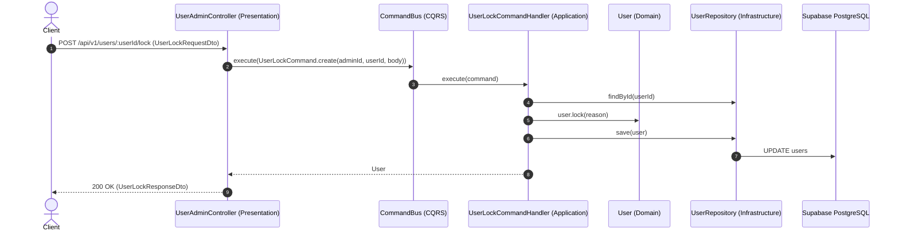

# NestJS Clean Architecture & CQRS Boilerplate

## Tài liệu xác thực

JWT sử dụng chữ ký RSA (`RS256`). Xem [tài liệu xác thực JWT bằng RSA](docs/jwt-rsa-authentication.md) để biết cách tạo key, cấu hình environment, sử dụng JWKS, xác thực token và rotate key.

Boilerplate chuẩn doanh nghiệp (Enterprise-ready) tinh gọn và rõ ràng, được xây dựng dựa trên **Clean Architecture**, **Domain-Driven Design (DDD)** và **CQRS (Command Query Responsibility Segregation)** trên nền tảng **NestJS** và **TypeORM (PostgreSQL)**.

---

## 🚀 Tính năng nổi bật (Key Features)

- **Kiến trúc phân tầng sạch (Clean Architecture & DDD)**: Tách biệt hoàn toàn giữa tầng Domain, Use-case (Application), Infrastructure và Presentation. Business logic không phụ thuộc vào framework hay cơ sở dữ liệu.
- **CQRS Pattern (@nestjs/cqrs)**: Tách bạch rõ ràng giữa Commands (Ghi/Sửa/Xóa dữ liệu), Queries (Đọc dữ liệu) và Events (Xử lý sự kiện nội bộ).
- **Dependency Inversion (DI Tokens)**: Sử dụng Symbol DI Token để đảo ngược phụ thuộc giữa Domain và Infrastructure.
- **Cơ sở dữ liệu (TypeORM & PostgreSQL)**: Cấu hình Data Source tối ưu, tự động mapping snake_case naming strategy, hỗ trợ Migration và Database Seeding (`typeorm-extension`).
- **Global Exception Filter chuẩn Clean Architecture**: Tự động nhận diện Domain Exception (`DomainException`), NestJS `HttpException`, và Validation errors để map HTTP status code chuẩn xác (404, 409, 400...).
- **Tài liệu API tự động (Swagger/OpenAPI)**: Tự động sinh tài liệu API trực quan tại `/api/v1/identity/swagger` (JSON: `/api/v1/identity/swagger/json`). Health check: `/api/v1/identity/health`.
- **Bộ khung thuần khiết (Pure Skeleton)**: Không chứa logic nghiệp vụ dư thừa, dễ dàng sao chép và mở rộng cho bất kỳ dự án nào.

---

## 📁 Cấu trúc thư mục (Directory Structure)

```text
Identity-Service/
├── .github/workflows/              # CI/CD và Supabase database keepalive
├── .env.example                    # Biến môi trường mẫu
├── Dockerfile                      # Multi-stage Docker build
├── start.sh                        # Script chạy migration -> start app
├── scripts/                        # Keepalive cho Supabase
├── docs/
│   ├── architecture.md             # Quy ước Clean Architecture + DDD (chung với boilerplate)
│   └── jwt-rsa-authentication.md
└── src/
    ├── main.ts                     # Bootstrap REST API & Swagger
    ├── app.module.ts               # Root module
    ├── config/service.constants.ts # ServiceConstants: PATH = identity, tên Swagger, DB mặc định
    ├── database/migrations/
    ├── shared/                     # Bản copy y hệt boilerplate — KHÔNG sửa riêng ở đây
    │   ├── domain/                 # BaseEntity, AggregateRoot, DomainException, Uuid, UserRole/UserStatus
    │   ├── application/            # Port (UnitOfWork, publisher), phân trang, AuthenticatedUser
    │   ├── infrastructure/         # Config, TypeORM, RabbitMQ, verify access token
    │   └── presentation/           # Guard, decorator, validator, filter/interceptor/pipe/middleware HTTP
    └── modules/
        ├── auth/                   # Đăng ký, đăng nhập, refresh/logout, reset mật khẩu, JWKS
        │   ├── domain/             # RefreshToken, PasswordResetToken, repository interface
        │   ├── application/
        │   │   ├── commands/       # auth-login/, auth-register/, password-reset-request/, …
        │   │   ├── event-handlers/ # Thu hồi token khi user bị khoá/xoá/đổi mật khẩu
        │   │   └── ports/          # ITokenService
        │   ├── infrastructure/     # persistence/, services/token.service.ts, config/jwt-config.service.ts
        │   └── presentation/http/  # controllers/, requests/, responses/, constants/
        ├── users/                  # Hồ sơ cá nhân + quản trị user
        │   ├── domain/             # User, Email, Phone, domain events
        │   ├── application/        # commands/, queries/, ports/ (IUserQueryService, IPasswordHasher)
        │   ├── infrastructure/     # persistence/, services/ (UserQueryService, BcryptPasswordHasher), seeds/admin.seeder.ts
        │   └── presentation/http/
        ├── landlord-profiles/      # Hồ sơ chủ trọ (payout account)
        ├── outbox/, inbox/         # Transactional outbox / consumer dedup (giống boilerplate)
        └── health/
```

Quy ước tầng, đặt tên use case (`<noun>-<verb>`) và cách đồng bộ `shared/` từ boilerplate:
[`docs/architecture.md`](docs/architecture.md).

---

## 🔄 Luồng xử lý CQRS (CQRS Architecture Flow)



---

## 🛠️ Hướng dẫn cài đặt & Khởi chạy

### Cách 1: Khởi chạy backend bằng Docker Compose

Docker Compose chỉ chạy backend; PostgreSQL được kết nối qua `DATABASE_URL` trên Supabase.
Đặt `DATABASE_URL` trong file `.env` ở thư mục `Identity-Service` trước khi chạy:

```bash
cd Identity-Service
docker compose up --build -d
```

- **Backend API**: `http://localhost:3001/api/v1`
- **Swagger Docs**: `http://localhost:3001/api/v1/identity/swagger`
- **Health**: `http://localhost:3001/api/v1/identity/health`

---

### Cách 2: Khởi chạy trực tiếp trên máy (Local Development)

#### 1. Cài đặt dependencies:
```bash
cd Identity-Service/backend
npm ci
```

#### 2. Cấu hình biến môi trường:
Đặt `DATABASE_URL` cho Supabase trong file `.env` tại thư mục `Identity-Service` (không ghi đè file `.env` hiện có). `MIGRATION_DATABASE_URL` có thể được đặt riêng nếu migration cần kết nối trực tiếp; khi bỏ trống, migration dùng `DATABASE_URL`. `DB_SSL` có thể để trống để tự nhận diện Supabase.

#### 3. Chạy Database Migrations:
```bash
npm run migration:run
```

#### 4. Khởi chạy ứng dụng:
```bash
npm run start:dev
```

#### 5. Kiểm tra kết nối Supabase (tùy chọn):
Từ thư mục `Identity-Service/backend`, chạy:
```bash
npx --yes tsx scripts/keep-alive.ts --dry-run
```

GitHub Actions keepalive chạy theo lịch mỗi ngày. Thêm secret `SUPABASE_DATABASE_URL` trong repository settings; có thể chạy thủ công ở chế độ kiểm tra kết nối (`dry_run`). Workflow deploy cần `DOCKERHUB_USERNAME` và `DOCKERHUB_TOKEN`; để bật deploy lên EC2, thêm `EC2_HOST`, `EC2_USER` và `EC2_SSH_KEY`.

---

## 📋 Hướng dẫn thêm Module mới chuẩn Clean Architecture & CQRS

Xem [`docs/architecture.md`](docs/architecture.md) mục 4–5 (layout module, quy ước đặt tên
`<noun>-<verb>`, các bước tạo domain → repository → use case → controller → module).
Module `users` là ví dụ đầy đủ nhất trong service này.

---

## 📜 Các lệnh Scripts hữu ích (NPM Scripts)

| Lệnh | Ý nghĩa |
| :--- | :--- |
| `npm run start:dev` | Chạy ứng dụng ở chế độ dev (watch mode) |
| `npm run build` | Biên dịch TypeScript sang JavaScript trong `dist/` |
| `npm run lint` | Kiểm tra và sửa lỗi coding convention với ESLint |
| `npm run format` | Tự động format code với Prettier |
| `npm run migration:create -- name=MigrationName` | Tạo một file migration mới |
| `npm run migration:generate -- name=MigrationName` | Tự động sinh migration từ Entity thay đổi |
| `npm run migration:run` | Áp dụng các migration chưa chạy vào Database |
| `npm run migration:revert` | Hoàn tác migration gần nhất |
| `npm run test` | Chạy unit test với Jest |

---

## 🛡️ License

Dự án phát hành theo giấy phép MIT.
